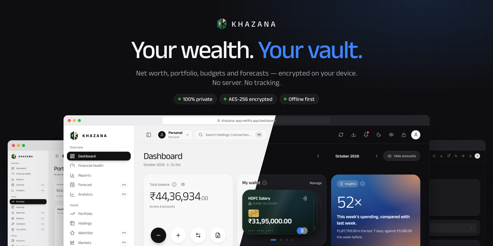
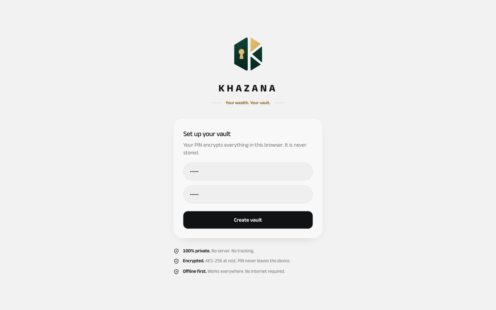
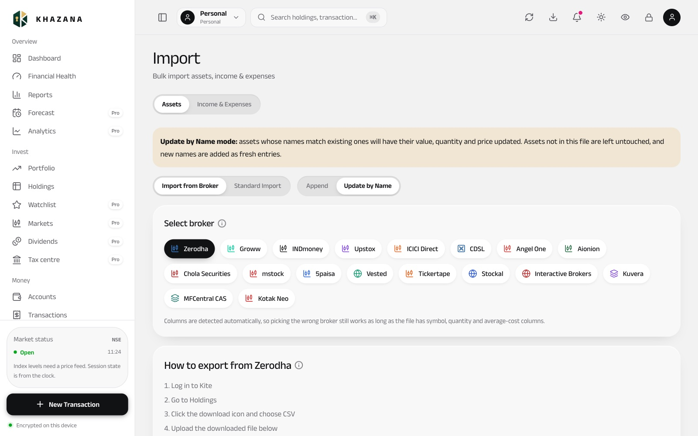
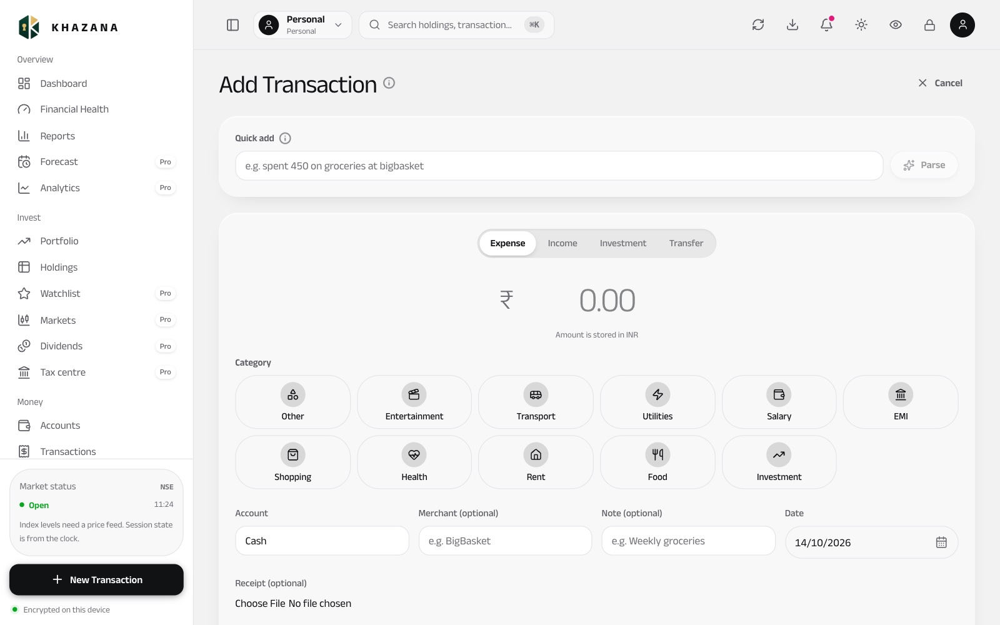
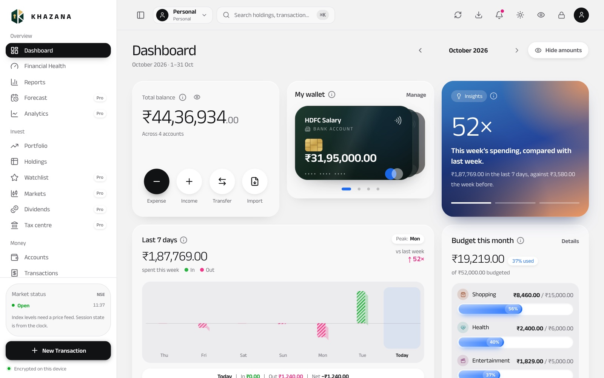
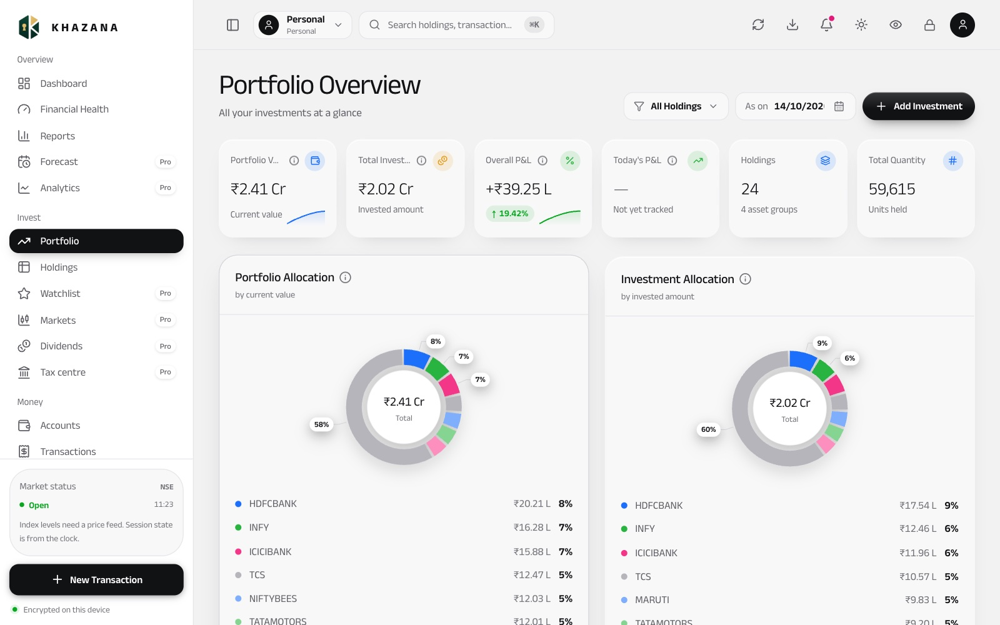
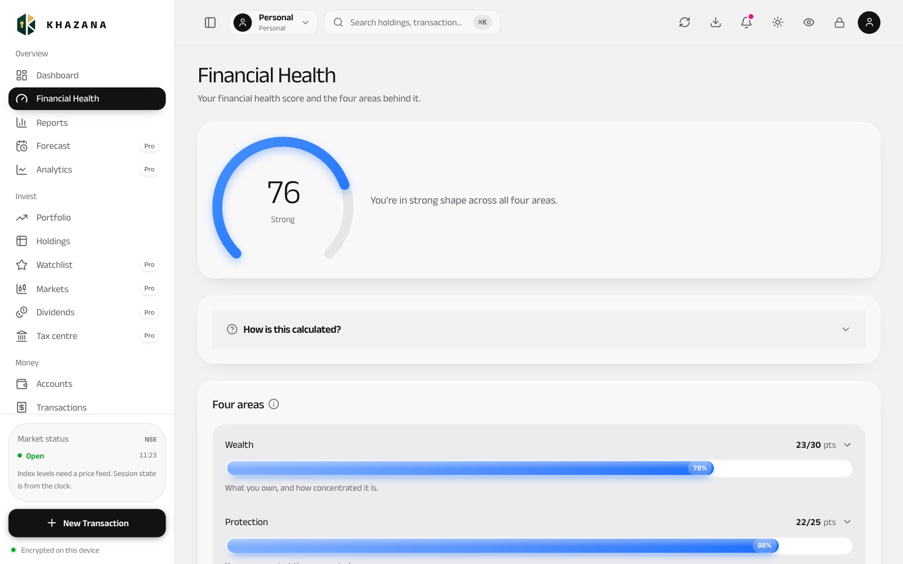
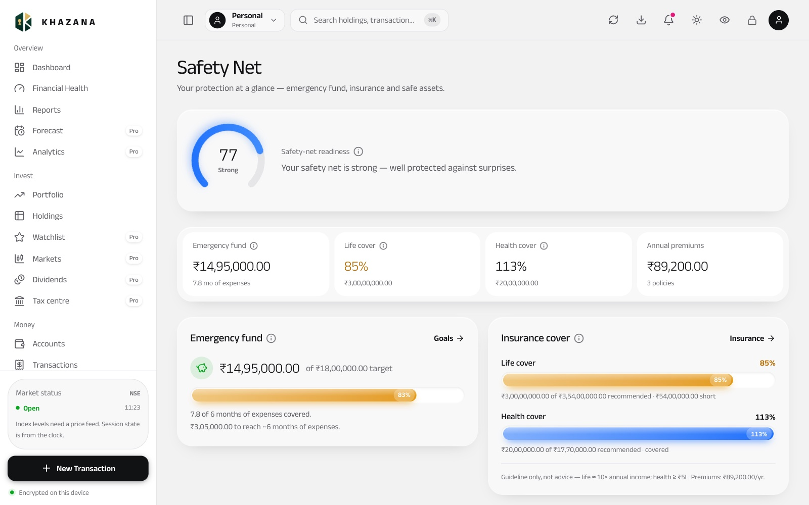
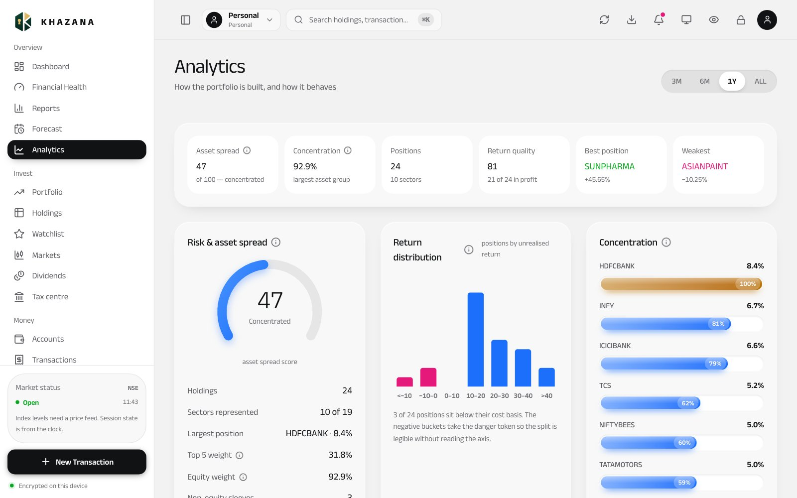
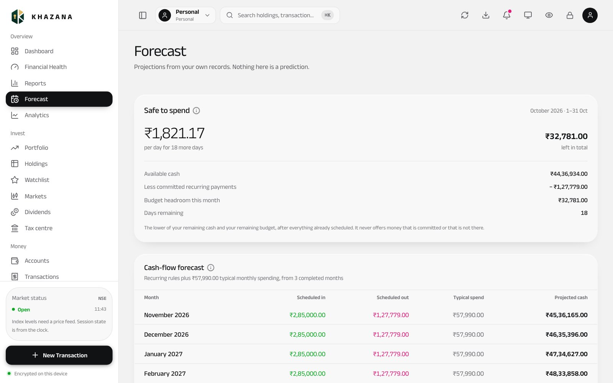

# Khazana — Offline-First, Encrypted Personal Finance Engine

<p align="center">
  
</p>

**[Try the demo in your browser →](https://khazana-app.netlify.app/demo/)** · opens
straight into a vault of sample data, no PIN, no signup, no install. The real app,
where you set your own PIN, is at [khazana-app.netlify.app](https://khazana-app.netlify.app)
— no data leaves your device; the link *is* the whole app.
&nbsp;·&nbsp; **[Technical case study →](docs/Khazana_Technical_Case_Study.pdf)**
&nbsp;·&nbsp; [Architecture](docs/ARCHITECTURE.md)
&nbsp;·&nbsp; [Threat model](docs/THREAT-MODEL.md)

Khazana is a **privacy-total, serverless** personal-finance app. All data lives
**encrypted at rest on the user's device** — there is no backend, no cloud
database, and no account server by design. It ships as **two parallel client
apps that share the same domain logic**:

- **Flutter app** (iOS / Android / macOS) — Dart, Riverpod, go_router, Drift ORM
  over **SQLCipher (AES-256)** encrypted SQLite.
- **Next.js web app** (`webapp/`) — React 19, TypeScript, Zustand, Dexie /
  IndexedDB, **Web Crypto AES-256-GCM**, optionally packaged as a desktop app
  with **Tauri 2**.

The financial **domain layer is framework-free** and deliberately ported between
Dart and TypeScript so both apps compute the same numbers. See
[docs/ARCHITECTURE.md](docs/ARCHITECTURE.md) and
[docs/THREAT-MODEL.md](docs/THREAT-MODEL.md).

## How it works

<table>
  <tr>
    <td width="50%" valign="top"><b>1 · Create your vault</b><br><picture><source media="(prefers-color-scheme: dark)" srcset="docs/showcase/vault-dark.jpg"></picture><br><sub>Pick a PIN of 6+ digits. It derives the AES-256 key through PBKDF2 (600,000 iterations) and is never stored. No account, no email, no server.</sub></td>
    <td width="50%" valign="top"><b>2 · Bring your data</b><br><picture><source media="(prefers-color-scheme: dark)" srcset="docs/showcase/import-dark.jpg"></picture><br><sub>Import holdings from 18 brokers and platforms (Zerodha, Groww, Upstox, ICICI Direct, CDSL, MFCentral CAS…) and income &amp; expenses from CSV. You can also start with <b>Settings → Load sample data</b> to explore.</sub></td>
  </tr>
  <tr>
    <td width="50%" valign="top"><b>3 · Record as you go</b><br><picture><source media="(prefers-color-scheme: dark)" srcset="docs/showcase/add-dark.jpg"></picture><br><sub>Add expenses, income, investments and transfers. Quick add understands plain text like <i>"spent 450 on groceries at bigbasket"</i>. Every entry posts to a double-entry ledger.</sub></td>
    <td width="50%" valign="top"><b>4 · See where you stand</b><br><picture><source media="(prefers-color-scheme: dark)" srcset="docs/showcase/dashboard-dark.jpg"></picture><br><sub>Net worth, cash flow, allocation and a financial-health score update instantly, all computed on your device. The screens below show the rest.</sub></td>
  </tr>
</table>

## Screenshots

Every screen follows your system theme. These shots use the built-in sample
vault (**Settings → Load sample data**). They are not real finances. GitHub
shows the light or dark set to match your own GitHub theme.

<table>
  <tr>
    <td width="50%" valign="top"><picture><source media="(prefers-color-scheme: dark)" srcset="docs/showcase/dashboard-dark.jpg"></picture><br><sub><b>Dashboard</b> — Net worth, cash flow and the 90-day trend</sub></td>
    <td width="50%" valign="top"><picture><source media="(prefers-color-scheme: dark)" srcset="docs/showcase/portfolio-dark.jpg"></picture><br><sub><b>Portfolio</b> — Holdings, allocation and P&amp;L</sub></td>
  </tr>
  <tr>
    <td width="50%" valign="top"><picture><source media="(prefers-color-scheme: dark)" srcset="docs/showcase/score-dark.jpg"></picture><br><sub><b>Financial health</b> — One score, four areas behind it</sub></td>
    <td width="50%" valign="top"><picture><source media="(prefers-color-scheme: dark)" srcset="docs/showcase/safety-net-dark.jpg"></picture><br><sub><b>Safety net</b> — Emergency fund, insurance and safe assets</sub></td>
  </tr>
  <tr>
    <td width="50%" valign="top"><picture><source media="(prefers-color-scheme: dark)" srcset="docs/showcase/analytics-dark.jpg"></picture><br><sub><b>Analytics</b> — Asset spread, concentration, return quality</sub></td>
    <td width="50%" valign="top"><picture><source media="(prefers-color-scheme: dark)" srcset="docs/showcase/forecast-dark.jpg"></picture><br><sub><b>Forecast</b> — Safe-to-spend and cash-flow projections</sub></td>
  </tr>
</table>

Brand images for social posts (LinkedIn, X, Instagram, Open Graph) are generated
by [`marketing/`](marketing/README.md).

## Highlights

- **Encryption at rest on both platforms** — SQLCipher (mobile) and Web Crypto
  AES-256-GCM (web), keyed by **PBKDF2-HMAC-SHA256 @ 600,000 iterations**, with
  biometric unlock and in-memory key purge on lock.
- **Framework-free financial engine** — financial-health score, net worth, XIRR,
  EMI / debt-payoff (avalanche & snowball), a config-driven capital-gains tax
  engine, insurance coverage-gap analysis, and a **Safety Net** readiness score.
- **Encrypted SQLite data layer** — Drift ORM, 13 tables, FTS5 full-text search,
  versioned schema migrations; money stored as `Decimal`/TEXT (no float error).
- **Serverless sync** — deterministic last-write-wins merge with 90-day
  tombstones for reconciling encrypted backups across devices.

## Repository layout

| Path | What |
|---|---|
| `lib/` | Flutter app — `domain/` (pure logic), `data/` (Drift/SQLCipher), `features/`, `core/`, `presentation/` |
| `webapp/` | Next.js web app (offline) — `src/lib/` (crypto, store, Dexie), `src/app/` (routes), `src/components/`; domain logic in `packages/domain-ts/` |
| `webapp-online/` | Khazana Online for the web — a separate app with an account and sync (ADR 0007); talks only to `backend/` through the gateway |
| `mobile-online/` | Khazana Online for phones — a separate Flutter app, `com.khazana.online` (ADR 0007); talks only to `backend/` through the gateway |
| `packages/` | Build-time shared code (ADR 0007): `domain-ts/` (TS domain logic + design tokens) |
| `test/` | Flutter unit / integration / golden / benchmark tests |
| `docs/` | Architecture and threat-model docs |
| `.github/workflows/` | CI — tests and static build for both stacks, visual regression screenshots, icon checks, advisory lint |

## Run it

**Flutter app**

```bash
flutter pub get
dart run build_runner build --delete-conflicting-outputs   # Drift/json codegen
flutter run            # or: flutter test
# Android has two flavors and needs one named:
#   flutter run --flavor sideload   # reads bank SMS (direct install / testers)
#   flutter run --flavor play       # the Google Play build, no SMS permission
```

**Web app**

```bash
cd webapp
npm ci
npm run dev            # http://localhost:3000
npm run test           # Vitest (domain + component tests)
npm run build          # static export to webapp/out/
```

## Benchmarks

Performance numbers are **measured**, not asserted from a spec — via committed
scripts:

```bash
node webapp/scripts/bench-crypto.ts                          # PBKDF2 + AES-GCM
flutter test test/benchmark/crypto_fts_bench_test.dart       # PBKDF2 + FTS5
```

See the results table in [docs/ARCHITECTURE.md](docs/ARCHITECTURE.md#measured-performance).

## Status & scope

Built solo. The web app is **live and usable today** (link at the top) and is
currently in **private beta with ten users**; the mobile builds are in release
preparation, where the critical path is Google Play's twelve-tester, fourteen-day
closed test for individual publishers rather than anything in the code. **No
public release yet, and no backend — the second one permanently.**

**Free for everyone.** Every feature, on every platform, with no ads, no
subscription, no paywall, no in-app purchase and no account. There is nothing to
unlock: both clients carry a test asserting that no screen is gated.

The security story is applied client-side cryptography (see the
[threat model](docs/THREAT-MODEL.md)), not web-auth or infrastructure security.

**Known limitations**, kept in the open rather than discovered by a user:
[`docs/APP-INVENTORY.md` §7](docs/APP-INVENTORY.md#7-defects) is a numbered
defect log that names what is broken and what has been fixed. Currently open:
no dedicated transaction-edit screen on Flutter, no pagination anywhere, and
`react-hooks/purity` lint debt under Next 16's ruleset — CI runs lint as an
advisory step while tests and the static build are hard gates.
